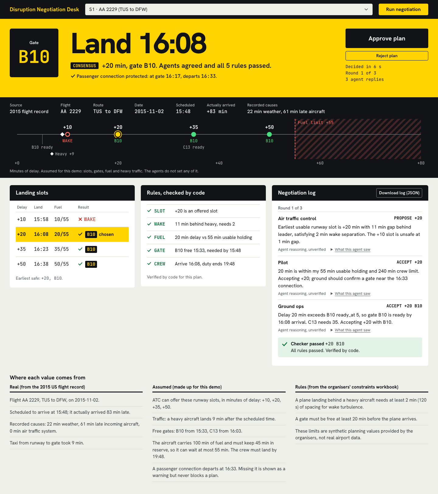

# Disruption Negotiation Desk

**Three AI agents (ATC, pilot, ground ops) negotiate a disrupted arrival in seconds. Plain-code rules decide what is safe. The duty manager approves.**


AUTONOMOUS SG 2026 · AI & Aerospace · Airbus Challenge #2 · **Live demo: https://agents-app-sandy.vercel.app**



**The problem.** When weather or a late aircraft disrupts an arrival, the airline's **hub operations duty manager** has to get three parties to agree on a new landing time and gate: **ATC** (runway slots, wake separation), the **flight crew** (fuel, duty hours) and **ground ops** (gates). Today that happens by phone, one party at a time. Each call can surface a new constraint and restart the loop, while the aircraft holds at about **$100.76 per minute** ([A4A, 2024](https://airlines.org/dataset/u-s-passenger-carrier-delay-costs/)).

**The solution.** Three separate LLM agents, each seeing only its own party's data, negotiate for **at most 3 rounds**. Every agreement is checked by **plain-code rules**. The duty manager gets **one safety-checked plan** (or an explicit "nothing is safe, you decide") with the full reasoning and log, then approves, rejects or takes over.

## Core features

- **Three independent agents, one message each per round.** ATC, pilot and ground ops are separate model calls with separate prompts and separate facts (the "What this agent saw" fold-out shows exactly what each was given). Consensus within 3 rounds, otherwise a deterministic fallback decides and the log says why.
- **A safety checker the AI cannot talk its way past.** Every agreement is tested against five rules (**SLOT, WAKE, FUEL, GATE, CREW**) with the numbers shown, e.g. `✓ FUEL 20 min delay vs 55 min usable holding`. Agent text is labelled *unverified*, checker output *verified by code*.
- **Constraint timeline.** Every offered landing slot on one axis: safe (green) or blocked (red, with the rule), plus the fuel limit, gate-ready times and heavy traffic. You see why the plan was chosen before reading a word of agent chat.
- **Any real flight, not a canned demo.** Pick one of 8 curated scenarios or paste **any row of the organisers' `flights.csv`**; plain code builds the scenario from the row plus the organisers' constraints workbook.
- **Human in control, fully traceable.** Approve, reject with a reason, or take over. One click downloads the consensus log: every message, verdict, reason, assumption and the human decision with timestamp.

### What makes it different

**The LLM talks; code decides.** The agents never make the safety call. They negotiate and explain; `checkProposal()` has the final word, and an agent's "I accept" never counts on its own.

**Why use agents at all, when a deterministic fallback can find a safe plan?** Because the fallback only works here because this demo hands it *every* party's data at once. In reality ATC, the crew and ground ops each hold their own constraints in separate systems; that separation is exactly why it is done by phone today. The agents let each party negotiate while sharing only offers, not data, and the checker stands in for the shared safety layer they would all have to accept.

## Results

| Metric | Result |
| --- | --- |
| Consensus on feasible scenarios (S1-S5, 3 runs each) | **15/15**, in **1.8 rounds** on average (limit 3) |
| Correct escalations on infeasible scenarios (S6-S8) | **9/9** |
| Plans outside the safe set | **0/24** |
| Time to a checked plan (live runs) | **about 6-20 s** |
| Real flights resolved automatically (500 sampled from `flights.csv`) | **434/500 (86.8%)**; 66 (13.2%) escalated to the duty manager |

Read the caveats in [Evaluation](#evaluation) and [Impact](#impact) before quoting these: the limits are synthetic, and the ground truth uses the same rules as the checker.

## Architecture

```
 Browser (Vue 3)                                   Vercel function            Anthropic API
┌─────────────────────────────────────────┐      ┌──────────────────────┐    ┌──────────────┐
│ App.vue  scenario picker / CSV row      │      │ api/agent.js         │    │              │
│          timeline, log, approve/reject  │      │  - rebuilds scenario │    │  Claude      │
│                                         │      │    from id / CSV row │───▶│  (one call   │
│ negotiate.js  round loop (max 3)        │─────▶│  - sanitises history │    │   per agent  │
│   for each role: { role, scenario, log }│ JSON │  - recomputes checks │◀───│   turn)      │
│   parseReply() → structured message     │◀─────│  - builds prompt     │    │              │
│                                         │      │    (src/prompts.js)  │    └──────────────┘
│ checker.js  (plain code, no AI)         │      └──────────────────────┘
│   checkProposal · ruleChecks · slotMap  │
│   fallback() → earliest safe plan       │
│   else ESCALATE → human decides         │
└─────────────────────────────────────────┘
 Data: scenarios.json (8 real BTS rows + synthetic limits) · airport_capacity.json (organisers' workbook)
```

| Part | Who | Where |
| --- | --- | --- |
| Proposing, countering, accepting | **LLM**, 3 separate calls per round, each with only its own facts | `src/prompts.js`, `api/agent.js` |
| Parsing replies (JSON only; bad shape becomes `INVALID`) | plain code | `parseReply` in `src/negotiate.js` |
| Accepting a plan: slot offered, wake gap, fuel, gate free 20 min before arrival, crew duty | **plain code** | `checkProposal`, `ruleChecks` in `src/checker.js` |
| Passenger connection (soft: warning only, never blocks) | plain code | `connectionStatus` |
| 3-round limit, fallback, escalation, reason text | **plain code** | `runNegotiation`, `fallback` |
| Building a scenario from any CSV row | plain code | `src/scenarioFromRow.js` |
| Final decision | **human** | Approve / Reject / take over |

**Stack:** Vue 3 + Vite + Bootstrap 5.3 (custom signage theme, Hanken Grotesk / JetBrains Mono; see `DESIGN.md`) · one Vercel serverless function · Anthropic Claude via `@anthropic-ai/sdk` · no database (scenarios are JSON; the log is a client-side download).

**Security:** `/api/agent` never accepts prompt text. The browser sends only a role, a scenario reference and the negotiation so far; the server rebuilds the scenario, sanitises the history and recomputes every checker verdict before building the prompt. So the endpoint is not a general Claude proxy and verdicts cannot be forged. Model and `max_tokens` (300) are fixed server-side. There is no rate limit, so set a spending limit on the API key.

## Setup (about 2 minutes)

**Prerequisites:** Node.js **20.19+ or 22.12+**, an Anthropic API key, and a Vercel account (free; `vercel dev` asks you to log in and link a project on first run).

```bash
git clone https://github.com/eujean-s/agents-app.git
cd agents-app
npm install
echo "ANTHROPIC_API_KEY=sk-ant-..." > .env   # your key; .env is git-ignored
npx vercel dev                               # app + /api/agent on http://localhost:3000
```

Open http://localhost:3000, pick **S1**, press **Run negotiation**. Try **S6** for an escalation, or **Custom** to paste any `flights.csv` row.

Optional, in a second terminal:

```bash
node scripts/evaluate.js 3                         # every scenario 3x against ground truth (uses the API)
node scripts/impact.js path/to/flights.csv 500     # impact measures, plain code, no API calls
```

## Evaluation

`node scripts/evaluate.js 3`: every scenario 3 times (24 runs, `claude-sonnet-5-5`, max 3 rounds, 20 min gate notice). A run is a mismatch if a feasible scenario ends outside `ground_truth.safe_options`, or an infeasible one does not end in ESCALATE.

- Consensus on S1-S5: **15/15** in **1.8 rounds** on average · checker-blocked proposals: **0** · fallback used: **0**
- Correct escalations on S6-S8: **9/9** · mismatches: **0/24**
- Passenger connection missed (soft warning): **12 of 15 plans**. In S2-S5 even the earliest safe slot misses it, so it is a human trade-off, not a negotiation failure.

**Caveats.** N=3 is small and LLM output varies between runs. The checker enforces the same rules `ground_truth` was computed with, so 0 mismatches shows the safety net holds; it is **not** independent validation.

### Where it fails

- **S6 is infeasible because of my numbers, not reality.** The real flight landed 112 min late; my assumed fuel leaves 40 min of holding and every runway slot is beyond it. The agents escalate correctly but reason about "diverting", an option the model does not have; only the plain-code fallback turns that into a clean ESCALATE.
- **LLM agreement is not safety.** In earlier runs the agents reached consensus on unsafe S7 plans (the checker blocked 1-3 per run). The latest run had none: that is run-to-run variation, not a fix.
- **Agents anchor on real numbers.** ATC sometimes cites the recorded delay ("matching the ~112 min delay") instead of what is safe.
- **Agent text can contradict the checker.** In one S1 run the pilot said the connection was "still at risk" while the checker showed it protected. That is why agent text is labelled unverified.

## Impact

`scripts/impact.js` (plain code, reproducible): every 717th row of `flights.csv` (358,774 rows, 500 sampled) is turned into a scenario with the same builder as the Custom option.

| Measure | 500 real flights | S1-S8 |
| --- | --- | --- |
| **Resolved automatically** (checked plan to approve) | **434/500 (86.8%)** | 5/8 |
| **Escalated** to the duty manager | **66/500 (13.2%)** | 3/8 |
| Single-party plan (ATC's earliest slot + first free gate, no cross-check) breaks a rule | 500/500 | 8/8 |
| Delay saved vs a cautious planner taking the latest safe slot | mean 10 min (about $1,005) | mean 9 min |

**What each number is worth:**

- **Resolved vs escalated is the meaningful result.** It depends on each flight's real recorded weather and air-system delay against the workbook's fuel rule. Claim: *on 500 real disrupted flights, the tool produced a safety-checked plan for 87% and sent 13% to the duty manager.* The slots and gates behind it are synthetic.
- **The 100% single-party failure rate is built into the scenario generator**, not a finding: the first gate opens when the first slot arrives, so with 20 min notice the earliest slot always fails GATE. It shows the checker catches the conflict, not how often it happens in reality.
- **"10 min / $1,005 saved" is an illustration**, driven by the assumed slot spacing and fuel limit, against a baseline I chose.
- **Not measured:** how long phone coordination takes today. Without that baseline, time saved per disruption cannot be stated.

**Delay cost references:** $100.76 per block minute, US passenger airlines 2024 ([A4A](https://airlines.org/dataset/u-s-passenger-carrier-delay-costs/)); about $33 B a year total US delay cost, 2019 (FAA/NEXTOR via [A4A](https://www.airlines.org/dataset/u-s-)); $32.9 B in 2007, of which $8.3 B airlines and $16.7 B passengers ([FAA Total Delay Impact Study](https://rosap.ntl.bts.gov/view/dot/6234)).

## Data: real vs assumed

| | Source |
| --- | --- |
| **Real** | Flight, route, date, scheduled and actual times, all delay causes, taxi times: BTS 2015 rows (8 curated scenarios, `csv_row` = row number; or any pasted `flights.csv` row) |
| **Rules** (organisers' `challenge2_operational_constraints.xlsx`, synthetic planning limits) | Gate change notice 20 min; Heavy-follows-Heavy wake spacing 120 s; 30 min final reserve + 45 min spare holding; 13 h crew duty; per-airport runway movements, spare gates, turnaround |
| **Assumed by me** | Runway slots offered, heavy arrivals, gate IDs and free times, fuel on board for curated scenarios (100 / 45 min, before the workbook was released), crew report time, passenger connection times |

| Scenario | Flight | Truth |
| --- | --- | --- |
| S1 | AA 2229 TUS-DFW | feasible (earliest slot wake-blocked) |
| S2 | MQ 3167 BNA-LGA | feasible |
| S3 | UA 646 ORD-EWR | feasible (earliest slot wake-blocked) |
| S4 | WN 1998 SAN-DEN | feasible |
| S5 | DL 795 GRR-MSP | feasible (earliest slot wake-blocked) |
| S6 | OO 2752 SAT-PHX | infeasible (FUEL, GATE) |
| S7 | US 561 PHX-LAS | infeasible (FUEL, GATE) |
| S8 | AS 37 MSP-SEA | infeasible (CREW, GATE) |

The *scenarios* are grounded in real delays; the *constraints* that make them feasible or not are assumptions. This demonstrates the negotiation and safety-check pattern, not real operational feasibility. Custom rows treat the whole delay as airborne holding, so long-delay rows escalate more often than they would in practice.

## Challenges overcome

- **JSON field order broke negotiations.** The first wake-separation run got 10/15 consensus and 9 unparseable replies: with `delay_min` before `message` in the reply schema, ATC committed to a wake-blocked slot and only then "changed its mind" in the text, so the numbers stopped matching. Putting `message` first (reason, then commit) fixed it: 14/15, 0 errors.
- **The rules changed mid-hackathon.** The organisers' update added a 20 min gate change notice, which made 4 of 5 feasible scenarios infeasible overnight. Rather than quietly keep the old rule, I adopted the official one and shifted the synthetic gate times by 20 min, so each scenario's ground truth is unchanged under the new rule (verified for all 8).
- **The public API was a free Claude proxy.** The first version forwarded any prompt. Prompts are now built server-side from a scenario reference, and checker lines are recomputed, so neither prompts nor verdicts can be injected.
- **Hard-coded demo vs real input.** The organisers' brief says "pick any row". A plain-code builder now turns any `flights.csv` row into a scenario using the workbook, with every remaining assumption listed per row.
- **Being honest about my own numbers.** The impact script's 100% figure looked great until it became clear it was built into the generator; the README says so instead of claiming it.

## What's next (with 3 more weeks)

- **Real constraints, not synthetic ones:** airport operational data (gate schedules, slot allocations) and FAA ASPM arrival rates, so feasibility reflects real operations.
- **Each party runs its own agent on its own data,** on its own infrastructure, sharing only offers: the real version of the information separation this demo simulates.
- **Measure the status quo:** time real phone coordination with ops staff to get the before/after baseline this project lacks.
- **More of the brief's constraints:** taxiway blockage, turbulence, ground-crew overtime, turnaround cost, and multi-flight conflicts competing for the same slots.
- **Production hardening:** authentication, rate limiting, audit storage for the consensus logs.

## License

MIT. See [LICENSE](LICENSE).
